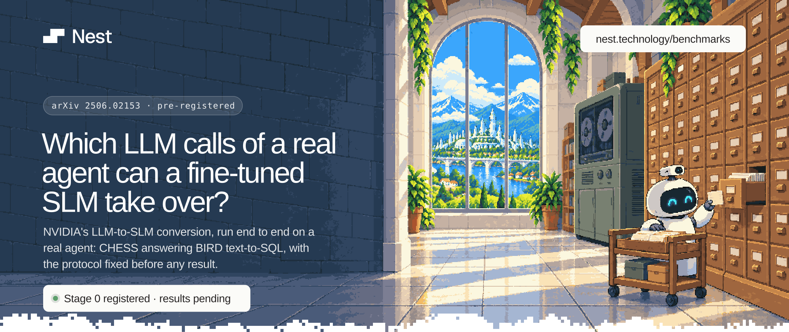
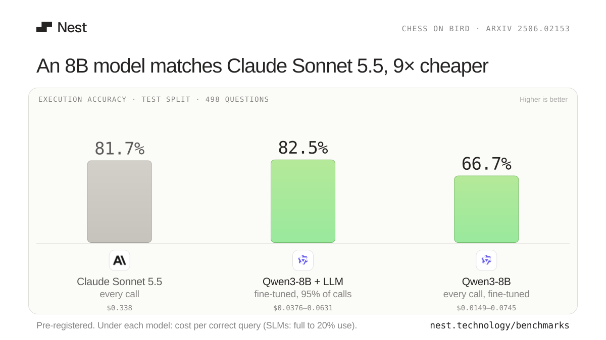

<picture>
  <source media="(prefers-color-scheme: dark)" srcset=".github/assets/hero-dark.svg">
  
</picture>

<br>
<br>

<p align="center">
  <a href="https://github.com/nest-ai-org/slm-conversion-bench/actions/workflows/ci.yml"></a>
  <a href="https://arxiv.org/abs/2506.02153"></a>
  <a href="prereg/STAGE0"></a>
  <a href="#results"></a>
  <a href="LICENSE"></a>
</p>

## The question

*Small Language Models are the Future of Agentic AI* (Belcak et al., NVIDIA Research,
[arXiv 2506.02153](https://arxiv.org/abs/2506.02153)) argues that most of an agent's calls to a large model could go to
a small, specialised one, and proposes an algorithm (S1–S6) to make the switch. It runs no experiment. This repository
runs that algorithm end to end on a real open-source agent, [CHESS](https://github.com/ShayanTalaei/CHESS), answering
[BIRD](https://bird-bench.github.io/) text-to-SQL questions, tested on
[Arcwise-Plat-SQL](https://github.com/uiuc-kang-lab/text_to_sql_benchmarks), and asks:

- which of the agent's LLM calls a fine-tuned SLM takes over **without losing quality**, against the LLM the agent uses;
- whether that still holds against **the cheapest alternative that needs no training**;
- at what **cost per correct answer**.

The protocol is [`SPEC.md`](SPEC.md) (in Portuguese), fixed before any result.

## Status

- ✓ **Harness:** built and tested against a fake server, a small local model and CPU training.
- ✓ **Stage 0:** the configuration and the verdict rules committed and timestamped ([`prereg/STAGE0`](prereg/STAGE0), OpenTimestamps).
- ○ **Day 1:** the pilot, the teacher's logs, curation, clusters, the SLM's choice, LoRA training. No paid run yet.
- ○ **Day 2:** the load test, the allocation, the pre-registration, the test split, the report.

[`RUNBOOK.md`](RUNBOOK.md) is the order of the two days, command by command.

## How it works

<picture>
  <source media="(prefers-color-scheme: dark)" srcset=".github/assets/how-dark.svg">
  
</picture>

Seven arms answer the same questions; each is the whole agent with its calls sent to a different engine:

| Arm | The agent's calls go to | It answers |
|---|---|---|
| **B0** | the production LLM, Claude Sonnet 5.5 | the quality ceiling and the reference cost |
| **B1** | a cheaper open-weight generalist, gpt-oss-120b, few-shot | the trivial alternative: a cheaper model, no training |
| **B2** | one call per question, no agent (production and cheap) | is the agent worth it? |
| **B3** | the chosen SLM, zero-shot | what specialising adds (against B4) |
| **B4** | the SLM fine-tuned with LoRA, one adapter per cluster, in every call site | the paper's V1 in its strongest form |
| **B5** | per cluster, the cheapest engine not worse than B0 | the paper's S6 |

The SLM candidates are Qwen3-8B and Granite-4.2-8B (Nemotron-3-Nano-4B in reserve). The LoRA adapters (r 16) are
trained with TRL and PEFT on Modal's L40S GPUs (the registered configuration) or on
[Tinker](https://thinkingmachines.ai/tinker/), Thinking Machines' fine-tuning API (`bench train --on tinker`, Qwen3-8B
only), and served with vLLM. Both backends write the same adapter and a manifest that pairs runs of the same plan, so
a Tinker adapter can be compared against a Modal one ([`RUNBOOK.md`](RUNBOOK.md), step 9).

## Results

<picture>
  <source media="(prefers-color-scheme: dark)" srcset=".github/assets/results-dark.svg">
  
</picture>

No paid run has happened yet, so there are no numbers. When there are, `bench report` writes `reports/<sha256>/`, and
this card is redrawn from its `report.json`:

```sh
python scripts/brand/results_card.py reports/<sha256> --out .github/assets --title "<the finding>"
```

The full report (every arm, every test, the SPEC §5 map) is the `report.md` beside it. The card changes no result and
no file of the registered analysis code.

## Run it locally (no paid calls)

<details>
<summary>The agent environment, a small local model, one question</summary>

```sh
uv venv .venv-agent --python 3.11
uv pip install --python .venv-agent/bin/python -r env/agent/requirements.lock -e ".[test]"
source .venv-agent/bin/activate

bench data                                   # download, check hashes, write splits
./scripts/serve-local.sh &                   # a small model on llama.cpp, OpenAI-compatible
bench preprocess --config configs/smoke-local.yaml --db debit_card_specializing
bench run --config configs/smoke-local.yaml --arm B0 --split train --ids 1470
bench eval <run_id printed above>
pytest
```

Every execution writes `runs/<run_id>/` with a `manifest.json` (commit, configuration hash, data hashes),
`calls.jsonl` and `predictions.json`. The test split is refused until the pre-registration hash (`prereg/HASH`) is
committed and pushed.
</details>

## Layout

<details>
<summary>What is where</summary>

| Path | What |
|---|---|
| `SPEC.md` | the protocol (v2.3); `SPEC-v1.md` is kept as the record of what changed |
| `RUNBOOK.md` | the two days of the experiment, command by command |
| `config.yaml` | C2: every parameter, including the models by role; `configs/` extend it |
| `bench/contracts/` | the contracts between the parts: C1 `calls.jsonl` (one line per LLM call), C2 configuration, C3 agreement between outputs, C4 the router |
| `bench/` | the harness: `data`, `run` and `replay` (agent executions), `curate` and `embed` (training examples and their clusters), `train`, `loadtest`, `eval` (execution accuracy), `prereg`, `verify`, `report`, the test barrier |
| `bench/judge/` | the judgments (J1–J8 and the choice of B1's few-shot k): pure functions over what the executions wrote |
| `modal_apps/` | training and vLLM serving on Modal |
| `vendor/chess/` | CHESS @ `3d6e835`, patched; every change is in [`vendor/chess/PATCHES.md`](vendor/chess/PATCHES.md) |
| `data/MANIFEST.json`, `data/splits.json` | hashes of every input and the train / calibration / test splits |
| `env/` | the three environments: `agent` (Python 3.11, CHESS's pinned LangChain 0.2), `analysis` (the judgments), `train` (training and serving) |
| `scripts/brand/` | the README's images in Nest's look: the hero, "How it works", the results card and the brand (standard library only) |
</details>

## Using a closed model as the teacher

The harness can call any engine with an OpenAI-compatible API and, through `endpoint.protocol:
anthropic`, Anthropic's Messages API. The registered configuration ([`config.yaml`](config.yaml)) makes
Claude Sonnet 5.5 the production LLM, the teacher whose answers the small models are trained on;
[`configs/teacher-claude.yaml`](configs/teacher-claude.yaml) swaps in Claude Opus 5.5.

**Whoever runs it is responsible for having the right to do so.** The pipeline does not only score the
teacher: steps S2–S5 fine-tune small models on its outputs. Most providers of closed models restrict, in
their terms, using outputs to train other models, and a subscription to a chat product is usually not
licensed for automated use as an API backend. Before training on any provider's outputs, read that
provider's current terms and obtain written permission where they require it. Record it in
`roles.production_llm.terms`: until it is filled, `bench preflight` fails and `bench curate` and
`bench train` refuse to turn the teacher's outputs into training data. The authors of this repository grant no such
right and take no responsibility for how it is used with any provider.

SPEC v2.2 (D6, D10) amended the design for this before Stage 0: up to v2.1 the teacher was an open-weight
model whose licence allows training on its outputs, and no closed LLM was in the core.

`bench run --via-claude-code` sends K1, the teacher's logs on train, through Claude Code instead of the
paid API; calibration and test always go through the API. Whoever runs it needs the provider's permission
for that use. The details of the registered run are in SPEC.md (D25).

## Cite

GitHub's *Cite this repository* reads [`CITATION.cff`](CITATION.cff). The paper this repository runs:

```bibtex
@misc{belcak2025slm,
  title         = {Small Language Models are the Future of Agentic AI},
  author        = {Peter Belcak and Greg Heinrich and Shizhe Diao and Yonggan Fu and Xin Dong and
                   Saurav Muralidharan and Yingyan Celine Lin and Pavlo Molchanov},
  year          = {2025},
  eprint        = {2506.02153},
  archivePrefix = {arXiv}
}
```

## Licenses

Code: Apache-2.0 ([`LICENSE`](LICENSE), [`NOTICE`](NOTICE)). CHESS is Apache-2.0. BIRD and
Arcwise-Plat-SQL are CC BY-SA 4.0 and are not redistributed here: `bench data` downloads them from
their publishers. Geist and Geist Mono, embedded in the README's images, are OFL-1.1
([`scripts/brand/fonts/OFL.txt`](scripts/brand/fonts/OFL.txt)); the model makers' logos in the results card are their
owners' trademarks, used only to name the models.

<p align="center"><sub>A <a href="https://nest.technology">Nest</a> research project · <a href="https://nest.technology/benchmarks">nest.technology/benchmarks</a></sub></p>

<picture>
  <source media="(prefers-color-scheme: dark)" srcset=".github/assets/footer-dark.svg">
  
</picture>
